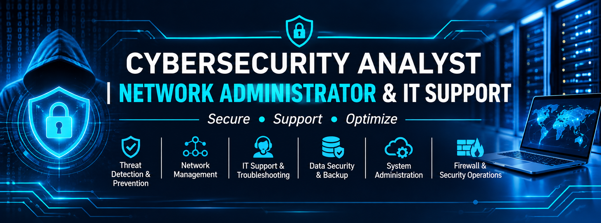

  

<h1 align="center">👋 Hello, I'm a Cybersecurity Analyst | Network Administrator & IT Support Professional</h1>

  <strong>🔐 Securing Systems | 🌐 Managing Networks | 🖥️ Supporting Technology</strong>

👨‍💻 About Me

I am an IT professional specializing in IT Support, Network Administration, Network Operations, and Cybersecurity. I am passionate about maintaining reliable IT infrastructure, troubleshooting complex technical issues, securing digital environments, and ensuring business systems operate efficiently.

My professional interests combine technical support, network management, and information security, with a strong focus on identifying vulnerabilities, mitigating security risks, and improving the reliability and resilience of IT systems.

I enjoy solving technical challenges, implementing practical IT solutions, supporting users, and continuously expanding my knowledge of emerging cybersecurity technologies and industry best practices.

🎯 Areas of Expertise

🖥️ IT Support & Technical Troubleshooting – Hardware and software troubleshooting, system configuration, user support, and technical maintenance.

🌐 Network Administration – Network configuration, LAN/WAN management, connectivity troubleshooting, and infrastructure support.

🔐 Cybersecurity Analysis – Security monitoring, vulnerability awareness, threat identification, and risk mitigation.

🛡️ Network Security – Access control, network protection, security protocols, and infrastructure hardening.

💾 Data Backup & Recovery – Data protection, backup management, recovery procedures, and business continuity.

🖨️ IT Infrastructure Management – Server support, printer troubleshooting, hardware maintenance, and IT asset management.

🚨 Incident Response – Security event investigation, log analysis, incident documentation, and remediation.

🛠️ Technical Interests

Cybersecurity Operations (SOC)

Network Security & Infrastructure

Vulnerability Assessment

Threat Intelligence

Incident Detection & Response

Windows & Linux Administration

Cloud Security Fundamentals

IT Service Management

System Monitoring & Troubleshooting

📚 Currently Learning & Improving

Advanced Cybersecurity Operations

Network Security and Threat Detection

Security Information and Event Management (SIEM)

Cloud Infrastructure and Security

Digital Forensics and Incident Response

Network Engineering and Administration

🚀 What You'll Find on My GitHub

This repository showcases my technical journey, practical projects, and continuous learning in IT support, networking, and cybersecurity.

You will find:

📁 IT support and troubleshooting documentation.

🌐 Network configuration and administration projects.

🔐 Cybersecurity labs and practical security exercises.

⚙️ System administration scripts and automation.

🚨 Security analysis and incident response projects.

📖 Technical documentation and knowledge-sharing resources.

🤝 Let's Connect

I am always interested in connecting with IT professionals, cybersecurity practitioners, network engineers, recruiters, and technology enthusiasts.

My goal is simple:

  <strong>🔐 Keep Systems Running | 🌐 Networks Connected | 🛡️ Digital Environments Secure</strong>

  <i>Thank you for visiting my GitHub profile!</i>
